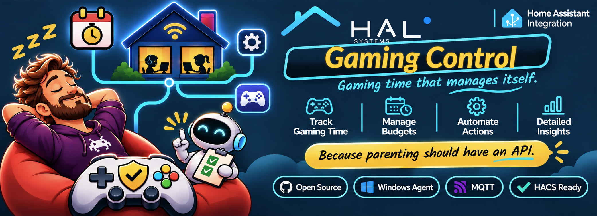
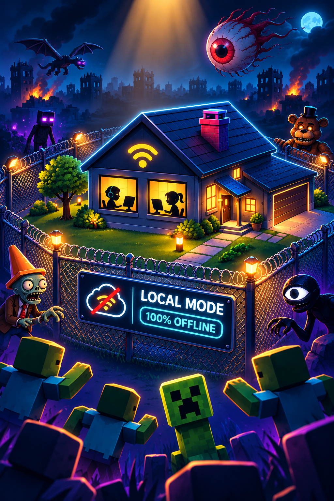
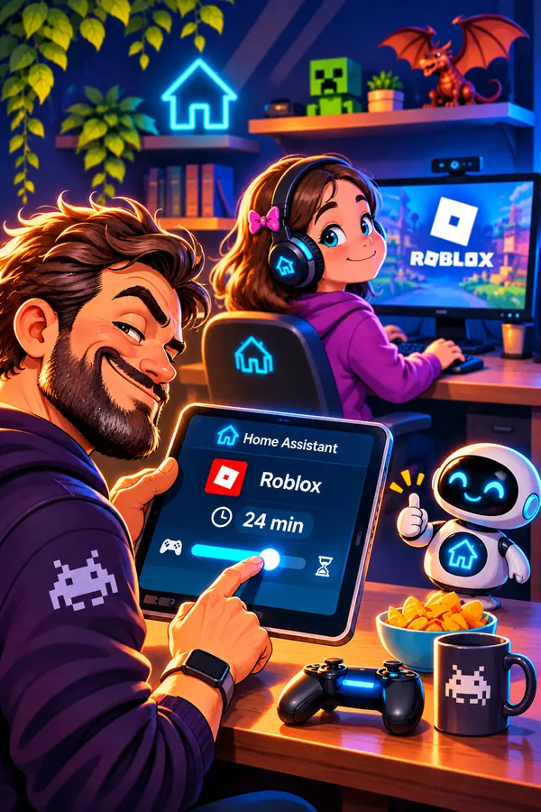
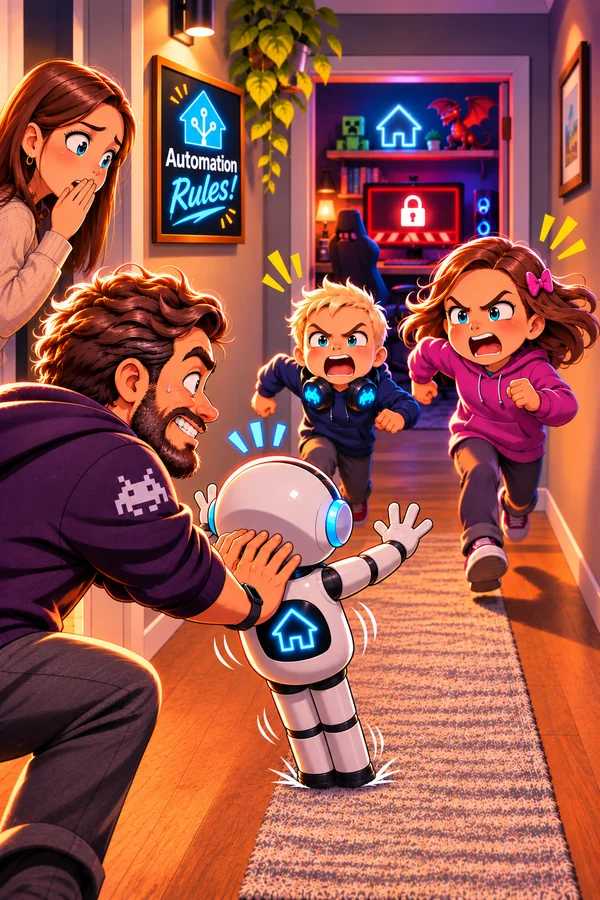
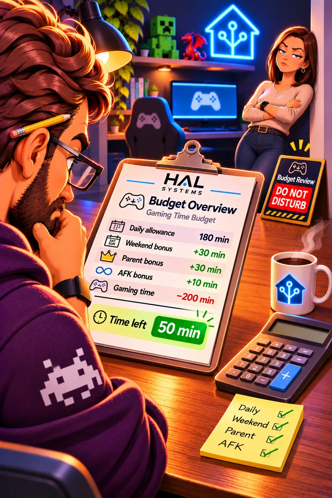

# HAL Gaming Control

**🚨 BREAKING — HA 0.13.3 / Windows agent 0.4.0:** HAL Gaming Control now uses **Unified MQTT v3 only**. Screen idle bonuses are automatic for supported verified display telemetry, with no per-PC opt-out; unknown display state does not prevent normal verified gameplay accounting. The Windows computer name is the MQTT device ID. Home Assistant has **no v2 monitoring, old Uptime fallback or telemetry selection option**; a legacy per-PC `unified_telemetry_enabled` setting is discarded automatically. Existing old-ID devices need explicit re-enrollment under the Windows hostname; settings and history are not silently remapped. [Upgrade guide](docs/unified_mqtt_telemetry.md) · [Release notes](docs/ha_releases.md). No deployment is implied by this source change.

**Because parenting should have an API.**

*Powered by HAL Systems.*

Heard “just five more minutes” again? Let Home Assistant keep track while you enjoy your coffee.

Track gaming time on Windows PCs, set limits, give bonus minutes and use parent controls when needed.

**🏠 Local-first. Your home, your data.** We built our own Windows service so PCs report activity and receive controls through **your MQTT broker and Home Assistant**, with no third-party cloud service in the control loop. Core tracking, budgets and manual controls run on your local network; internet access may still be used for installation, updates or optional online data sources. [See how local mode works](docs/features/local-mode.md).

*Emotionally off duty, not legally. Please don't actually outsource parenting to a YAML file.*

## What can it do?

<table>
  <tr>
    <td width="132" valign="middle">
      
    </td>
    <td valign="middle">
      <h3>🏠 100% local — the monsters stay outside. So does the cloud.</h3>
      
We built our own <strong>Windows service</strong> so gaming activity and parent commands travel through <strong>your local MQTT broker and Home Assistant</strong>, not somebody else's cloud. The only boss battle is at home.

      
<a href="https://github.com/mhalak/hal-gaming-control/blob/main/docs/features/local-mode.md">How local mode works</a>

    </td>
  </tr>
</table>

<table>
  <tr>
    <td width="132" valign="middle">
      
    </td>
    <td valign="middle">
      <h3>⏱️ Gaming budgets — the clock doesn't negotiate.</h3>
      
The king can grant <strong>30 bonus minutes today</strong> or an additive <strong>Weekend bonus</strong> every Saturday and Sunday. The weekly budget, however, refuses to bow.

      
<a href="https://github.com/mhalak/hal-gaming-control/blob/main/docs/features/gaming-budgets.md">Budgets &amp; bonuses explained</a>

    </td>
  </tr>
</table>

<table>
  <tr>
    <td width="132" valign="middle">
      
    </td>
    <td valign="middle">
      <h3>🎮 Track applications — not just games.</h3>
      
Choose what to track: Roblox, Minecraft or another app. Home Assistant gives each one a friendly name. <em>Development preview.</em>

      
<a href="https://github.com/mhalak/hal-gaming-control/blob/main/docs/features/tracked-applications.md">How to track an application</a>

    </td>
  </tr>
</table>

<table>
  <tr>
    <td width="132" valign="middle">
      
    </td>
    <td valign="middle">
      <h3>🪄 Controls &amp; automations — Automation Rules!</h3>
      
Need a manual stop? Use <strong>Lock PC</strong> or <strong>Terminate game</strong>. The real magic is native Home Assistant automations: you set the reminders and rules, and let the robot handle “five more minutes.” <strong>Automatic enforcement still needs testing.</strong>

      
<a href="https://github.com/mhalak/hal-gaming-control/blob/main/docs/features/parent-actions.md">How controls and automations fit together</a>

    </td>
  </tr>
</table>

<table>
  <tr>
    <td width="132" valign="middle">
      
    </td>
    <td valign="middle">
      <h3>🌙 AFK grind — the loot won't mine itself.</h3>
      
<strong>Planned.</strong> The child sleeps. The game keeps grinding. Screen-off time would stop counting, with an optional bonus for eligible idle time before the screen switched off.

      
<a href="https://github.com/mhalak/hal-gaming-control/blob/main/docs/features/screen-idle-bonus.md">How Screen idle bonuses will work</a>

    </td>
  </tr>
</table>

<table>
  <tr>
    <td width="132" valign="middle">
      
    </td>
    <td valign="middle">
      <h3>🧾 Budget overview — the gaming-time audit.</h3>
      
<strong>Source preview (#93).</strong> Daily allowance + bonuses − time played = time left. A native HA dashboard receipt is available in source once the corresponding PR is merged and installed. Dad has the receipts. Mum would like the audit to end.

      
<a href="https://github.com/mhalak/hal-gaming-control/blob/main/docs/features/budget-overview.md">See the proposed Budget overview</a>

    </td>
  </tr>
</table>

**Development preview.** Features depend on the installed version. Screen idle bonuses are experimental and require explicit opt-in and real-PC acceptance. The itemized Budget Overview requires a build containing #93; it is not part of older installed versions. Don't enable automatic game closing or locking before testing on your PC. [What's ready and what's missing](docs/known_limitations.md).

## Windows setup (simpler, safer)

Windows agent **0.4.0+** uses the actual Windows computer name for both MQTT routing and discovery; no saved or configured independent `device_id` exists. HA **0.13.0+** consumes only v3 `state/telemetry` and requires v3-capable discovery. Back up existing settings before enrolling an upgraded PC under its hostname. Tracked applications, budgets and manual actions remain HA-owned. [Current Windows installation and clean-cut migration](docs/windows_deployment.md).

## Want to get started?

**[Browse the guides](docs/README.md)** for setup and everyday use. Need more detail? See [Windows setup](docs/windows_deployment.md) and [Home Assistant setup](docs/ha_integration.md).

## Changelog — patch notes and occasional boss fights

Kids call it a new level. Developers call it a **BREAKING CHANGE**. Parents call it *“Why did this stop working?”*

[Read the version-by-version changelog](docs/changelog.md) — with upgrade warnings before the next boss fight.

## The fine print (someone has to be the adult)

This is a family tool, **not** unbreakable security or a replacement for parenting. Missing data can leave gaps in playtime history; closing a game can lose unsaved progress. Keep your home network secure. **Never turn off Windows security protections** just to install it. [Known limitations](docs/known_limitations.md) · [Privacy details](docs/mqtt_protocol.md).

### Development disclosure: even the developer has been automated

Our reluctance to perform repetitive parenting duties apparently extends to software development, too.

After deciding to delegate gaming-time negotiations to Home Assistant, we thought: why stop there? So we recruited OpenAI's ChatGPT (including GPT-6) and Codex to help design, implement, review, test and document this project.

The human developer still makes the architectural decisions, defines the requirements and oversees testing on real hardware. Someone has to be responsible around here, and the AI refuses to sign school permission slips.

We follow trunk-based development, use automated tests and CI, and validate Windows service behavior on actual PCs. AI-assisted code is not a guarantee of correctness; bugs are still possible. Please report them.

**No AI subscription required:** AI is a development tool here, not a runtime dependency. The integration and Windows agent do not require ChatGPT, an OpenAI API key or an AI service to operate. Gaming telemetry stays within the configured MQTT and Home Assistant setup during normal operation.

In short: we automated the parenting, then automated part of the programming. Writing this disclaimer was, naturally, also AI-assisted.

**Curious how much AI it takes to build a tool that limits screen time?**

Apparently, quite a lot of screen time. And about **440 million tokens**. The irony is not lost on us.

[See the AI development cost report](docs/ai-development-cost.md).

Not affiliated with Home Assistant, HACS, Microsoft, Roblox or Minecraft. [Development and contribution details](docs/README.md#for-contributors).
