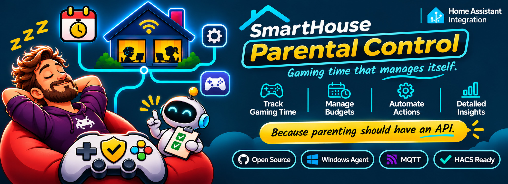

# SmartHouse Parental Control

**Because parenting should have an API.**

*Powered by HAL Systems.*

Tired of negotiating "just five more minutes" for the seventh time tonight? Let Home Assistant keep score while you enjoy your coffee.

It tracks gaming budgets on Windows PCs, lets parents grant bonus minutes, and provides explicit controls when negotiations fail. No cloud account or recurring parental-control subscription required.

*Emotionally off duty, not legally. Please don't actually outsource parenting to a YAML file.*

## What can it do?

<table>
  <tr>
    <td width="132" valign="middle">
      
    </td>
    <td valign="middle">
      <h3>⏱️ Gaming budgets — the clock doesn't negotiate.</h3>
      
Daily and weekly limits keep score. Feeling royal? Press <strong>Add 30 minutes</strong>. The daily allowance grows; the weekly limit remains unimpressed.

      
<a href="docs/features/gaming-budgets.md">Budgets &amp; bonuses explained</a>

    </td>
  </tr>
</table>

<table>
  <tr>
    <td width="132" valign="middle">
      
    </td>
    <td valign="middle">
      <h3>🎮 Track applications — not just games.</h3>
      
Roblox, Minecraft, even a suspicious <code>javaw.exe</code>: Windows reports the foreground app; Home Assistant gives it a friendly name. The gaming chair is no alibi. <em>Development preview.</em>

      
<a href="docs/features/tracked-applications.md">How to track an application</a>

    </td>
  </tr>
</table>

<table>
  <tr>
    <td width="132" valign="middle">
      
    </td>
    <td valign="middle">
      <h3>🪄 Controls &amp; automations — Automation Rules!</h3>
      
Use <strong>Lock PC</strong> or <strong>Terminate game</strong> manually. Native HA automations are the real magic: let the house handle the seventh “five more minutes.” <strong>Automatic restriction enforcement is not yet validated.</strong>

      
<a href="docs/features/parent-actions.md">How controls and automations fit together</a>

    </td>
  </tr>
</table>

<table>
  <tr>
    <td width="132" valign="middle">
      
    </td>
    <td valign="middle">
      <h3>🌙 AFK grind — the loot won't mine itself.</h3>
      
<strong>Planned.</strong> Kids could sleep while their game keeps grinding. Confirmed screen-off time would stop counting; an optional bonus could restore eligible idle minutes <em>before</em> screen-off.

      
<a href="docs/features/screen-idle-bonus.md">How Screen idle bonuses will work</a>

    </td>
  </tr>
</table>

<table>
  <tr>
    <td width="132" valign="middle">
      
    </td>
    <td valign="middle">
      <h3>🧾 Budget overview — the gaming-time audit.</h3>
      
<strong>Planned.</strong> Daily allowance + bonuses − measured playtime = remaining minutes. Dad has the receipts. Apparently “five more minutes” requires an auditor.

      
<a href="docs/features/budget-overview.md">See the proposed Budget overview</a>

    </td>
  </tr>
</table>

**Development preview, not a finished family appliance.** The repository contains a Home Assistant integration and a Windows companion; feature availability depends on the deployed version. The app editor and other preview features still require complete end-to-end acceptance. Screen idle bonuses and the itemized Budget overview are **not implemented yet**. Do not turn on automatic enforcement until your own setup has been validated. [Release status and known limitations](docs/known_limitations.md).

## Want to get started?

**[Browse the documentation](docs/README.md)** for the beginner-friendly how-tos, screenshots when available, installation instructions, troubleshooting and engineering details. Or go directly to the [Windows deployment guide](docs/windows_deployment.md) and [Home Assistant setup](docs/ha_integration.md).

## The fine print (someone has to be the adult)

This is a family convenience tool, **not** tamper-proof security software or a substitute for parenting. A local administrator can stop it; missing telemetry can make measurements incomplete; terminating a game can lose unsaved progress. Keep MQTT private and restrict credentials. Do not disable Windows Smart App Control or Defender to install an unsigned development build. [Read the limitations](docs/known_limitations.md) and [privacy and protocol notes](docs/mqtt_protocol.md).

### Development disclosure: even the developer has been automated

Our reluctance to perform repetitive parenting duties apparently extends to software development, too.

After deciding to delegate gaming-time negotiations to Home Assistant, we thought: why stop there? So we recruited OpenAI's ChatGPT (including GPT-6) and Codex to help design, implement, review, test and document this project.

The human developer still makes the architectural decisions, defines the requirements and oversees testing on real hardware. Someone has to be responsible around here, and the AI refuses to sign school permission slips.

We follow trunk-based development, use automated tests and CI, and validate Windows service behavior on actual PCs. AI-assisted code is not a guarantee of correctness; bugs are still possible. Please report them.

**No AI subscription required:** AI is a development tool here, not a runtime dependency. The integration and Windows agent do not require ChatGPT, an OpenAI API key or an AI service to operate. Gaming telemetry stays within the configured MQTT and Home Assistant setup during normal operation.

In short: we automated the parenting, then automated part of the programming. Writing this disclaimer was, naturally, also AI-assisted.

Not affiliated with Home Assistant, HACS, Microsoft, Roblox or Minecraft. [Development and contribution details](docs/README.md#for-contributors).
