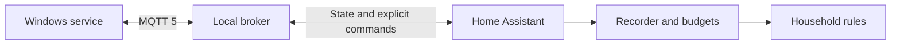

# SmartHouse Parental Control

**Because parenting should have an API.**

*Powered by HAL Systems.*

Tired of being the bad guy? Done saying "five more minutes" for the seventh time tonight? Let Home Assistant handle the negotiations while you enjoy your coffee.

Set gaming budgets, hand out bonus minutes, and let your smart home deliver the bad news. Your kids can argue with the automation. You're officially off duty.*

*Emotionally, not legally. Please don't actually outsource parenting to a YAML file.*

## What is this?

A local-first Home Assistant integration and a companion Windows service for managing gaming time across multiple family PCs. The service reports telemetry over MQTT and exposes explicit actions; Home Assistant stores history, maintains budgets, and lets you set household rules. No cloud account or external parental-control subscription is required.

## Verified core functionality

In live maintainer smoke testing, both explicit Windows control actions worked: **Terminate game** terminated the configured application on request, and **Lock PC** locked the workstation on request. This establishes a working core control path, not full per-device regression, foreground accounting, automatic enforcement, or production release acceptance. The project is a source-only development preview, not a stable binary release.

## Product features and development status

HA 0.4.2 is the current source baseline. "Available" means implemented in this development snapshot, not stable-release acceptance. The two manual actions passed live maintainer smoke tests. Planned HA 0.5.0 features are not included. See the [product direction](docs/product_direction.md) for the roadmap.

| Feature | Status | What it does |
| --- | --- | --- |
| Daily and weekly budgets | Available (0.4.2) | Remaining percentages and minute attributes per PC; process-presence accounting. |
| Weekend daily override | Available (0.4.2, legacy) | Replaces the daily allowance on weekends; disabled override falls back to the daily allowance. |
| Weekend bonus | Planned (0.5.0) | Add extra minutes to the daily allowance each Saturday and Sunday. |
| Dedicated gaming-time sensors | Planned (0.5.0) | Display daily and weekly accounted minutes independently of enabled restrictions. |
| Internal action selectors | Available (0.4.2, legacy) | Configure internal automatic actions when a live game violates policy; keep restrictions off until validated. |
| Restriction signal and automation-owned execution | Planned (0.5.0) | Use a binary sensor to trigger your own Home Assistant automations instead of internal execution. |
| Add 30 minutes | Available (0.4.2) | Grant today's allowance a temporary, cumulative extension; reset at local midnight. |
| Unlimited gaming | Available (0.4.2) | Temporarily bypass automatic restrictions without clearing recorded usage. Manual actions remain available. |
| Terminate game | Available (live smoke-tested) | Request termination of matching running game processes. |
| Lock PC | Available (live smoke-tested) | Request a Windows workstation lock. The user can still unlock normally. |
| Agent version | Available (0.4.2) | See the last reported Windows service version, even when the PC is offline. |
| Multiple PCs | Available (0.4.2) | Independently configure each discovered Windows device; full per-device acceptance pending. |
| MQTT discovery | Available (0.4.2) | Standard MQTT discovery or the integration's scoped onboarding. |

**Important:** the current HA accounting measures configured *running processes*, not foreground play. Background processes can consume budget. The Windows 0.2.x agent publishes foreground telemetry (`gaming_active`, `active_game`), but HA foreground-only accounting is still pending. Do not configure enforcement automations until you have verified the behavior on your own machines.

## What about Linux gaming?

If you're the kind of parent who games on Linux, you've probably already written three shell scripts, a cron job and a custom kernel patch to manage your kids' screen time.

We figured you enjoy doing everything manually anyway. Why take away your fun?

So, in true Linux spirit, the Linux gaming agent is left as an exercise for the reader.

Jokes aside: the companion service currently supports Windows 10/11 only. Home Assistant and your MQTT broker can run on Linux, Docker or any supported HA platform.

## Requirements

- Home Assistant with MQTT and Recorder configured. The validated HA baseline is 2026.10.2; earlier versions are not yet verified.
- MQTT 5-capable broker accessible from HA and the Windows PCs (for example, Mosquitto).
- Windows 10/11 x64 PC, administrator access for installation, and Python 3.12 on the build machine if building from source.
- A unique device ID and least-privilege MQTT credentials for each PC. Use TLS where appropriate. Do not expose the broker to the public internet.

## Installation

### 1. Configure MQTT

Configure the broker using Home Assistant's built-in MQTT integration: **Settings → Devices & services → MQTT → Configure**. The parental-control integration uses that existing connection; it does not create a competing MQTT client inside HA. Global MQTT discovery can stay disabled.

Configure the Windows companion with the same broker host, port, TLS settings and its own restricted credentials in `windows_agent/config.yaml`. See [MQTT setup](docs/mqtt_setup.md). Never commit a real configuration or password.

### 2. Install the Windows companion

HACS installs the HA integration only; it cannot install a Windows service on a remote computer.

For development testing only, build the Windows agent from an exact reviewed source revision using the [Windows deployment guide](docs/windows_deployment.md). Record the revision and actual component version. No stable branch, trusted public executable, or signed update channel is offered by this source-only preview. The optional remote updater is experimental and must remain disabled for preview testing. Confirm live telemetry before enabling restrictions; never bypass Windows security controls.

### 3. Install the Home Assistant integration

**HACS custom repository (future, after official validation and install acceptance):**

1. Open HACS, then the menu → Custom repositories.
2. Add this repository URL and select **Integration**.
3. Search for **SmartHouse Parental Control**, download an explicitly validated version once available and restart Home Assistant.
4. Go to Settings → Devices & services → Add integration → SmartHouse Parental Control. Select your Windows PC, or accept its discovered entry.
5. Repeat for additional PCs.

HACS installation is not yet validated for this preview and no stable release is offered. Public HACS catalog inclusion is a planned milestone, not an existing listing. Use manual installation on a disposable HA test instance for source-preview evaluation.

**Manual installation:** copy the entire `custom_components/smarthouse_gaming/` directory into HA's `config/custom_components/`, then restart and add the integration. Preserve the existing folder/domain when upgrading from SmartHouse Gaming Control; no re-pairing is intended.

### 4. Configure budgets and actions (current 0.4.2 preview)

Use the Daily limit, Weekly limit and Weekend daily limit controls. The weekend value replaces the daily allowance on Saturday and Sunday; -10 on the weekend slider falls back to the daily allowance, while -10 on daily/weekly sliders disables that limit. Add 30 minutes grants a same-day extension; Unlimited gaming bypasses restrictions without clearing usage. Keep restrictions disabled during preview testing: legacy internal action selectors can execute commands automatically when policy is enabled. See the [0.4.2 reference in the integration guide](docs/ha_integration.md#legacy-042-reference). Under Configure, the MQTT screen explains the shared connection; change the broker in HA's built-in MQTT integration.

The additive Weekend bonus and automation-owned enforcement with a restriction signal are planned HA 0.5.0 behavior, not available in this snapshot. See the roadmap and version-specific integration guide for migration details.

## Roadmap: let your house be the referee

- Daily and weekly accounted time sensors, additive Weekend bonus and automation-owned enforcement (candidate, pending validation).
- Count only the monitored application in foreground. Background/minimized apps do not consume time; unknown is distinct from idle.
- Application list in HA Options Flow: enroll the live foreground application with a readable name, including non-game applications, without a mandatory game catalog.
- Windows warning popup with a large remaining-time countdown and a bar that drains from full to empty; green/yellow/red thresholds, 60/10/1/0 minute alerts and **Powered by HAL Systems** footer.
- Later — Optional parent-controlled request for five more minutes.

See [agreed product direction](docs/product_direction.md) for details and implementation boundaries.

## How it works

One HA integration directory, a separate Windows companion, and independent build versions. See [Windows deployment](docs/windows_deployment.md), [HA setup and daily use](docs/ha_integration.md), [wire protocol](docs/mqtt_protocol.md), [HA release history](docs/ha_releases.md), [MQTT troubleshooting](docs/mqtt_setup.md), and [release checklist](docs/hacs_release.md).

## Known limitations

The current Windows development agent is unsigned; Smart App Control has blocked service startup on a test PC. Trusted Authenticode signing and real SAC-enforced installation acceptance are trusted binary distribution and stable-release gates, not claims of this source-only preview. Do not disable Windows security to install the agent. Foreground-only accounting, remote updates and full hosted CI acceptance also remain open. See [known limitations and release blockers](docs/known_limitations.md) for the observed failures, current status and follow-ups.

## Safety and privacy

This is a family convenience tool, not a tamper-proof security product or a substitute for conversation and supervision. A local administrator can stop the service. Time is only accounted for when telemetry is observed; connectivity outages and Recorder gaps are imperfectly measured. Force-terminating a game can lose unsaved progress. Test actions on disposable sessions, use separate broker accounts and ACLs, and keep logs/configuration private. Do not use real children's names, home addresses, credentials, tokens, or raw personal logs in public issue reports.

## Development disclaimer: even the developer has been automated

Our reluctance to perform repetitive parenting duties apparently extends to software development, too.

After deciding to delegate gaming-time negotiations to Home Assistant, we thought: why stop there? So we recruited OpenAI's ChatGPT (including GPT-6) and Codex to help design, implement, review, test and document this project.

The human developer still makes the architectural decisions, defines the requirements and oversees testing on real hardware. Someone has to be responsible around here, and the AI refuses to sign school permission slips.

We follow trunk-based development, use automated tests and CI, and validate Windows service behavior on actual PCs. AI-assisted code is not a guarantee of correctness; bugs are still possible. Please report them.

**No AI subscription required:** AI is a development tool here, not a runtime dependency. The integration and Windows agent do not require ChatGPT, an OpenAI API key or an AI service to operate. Gaming telemetry stays within the configured MQTT and Home Assistant setup during normal operation.

In short: we automated the parenting, then automated part of the programming. Writing this disclaimer was, naturally, also AI-assisted.

## Development and support

Report reproducible issues using the issue template, with sanitized evidence and both component versions. Contributions should preserve device identities, existing MQTT topics and configuration. Run Windows CI, HA CI, Direct MQTT CI, Recorder coverage CI, and the HACS checks before release. Hosted CI has not yet passed on the preview candidate; official HACS/Hassfest and Windows acceptance remain outstanding. No stable release, HACS catalog submission or public binary distribution is implied.

Not affiliated with Home Assistant, HACS, Microsoft, Roblox or Minecraft.
