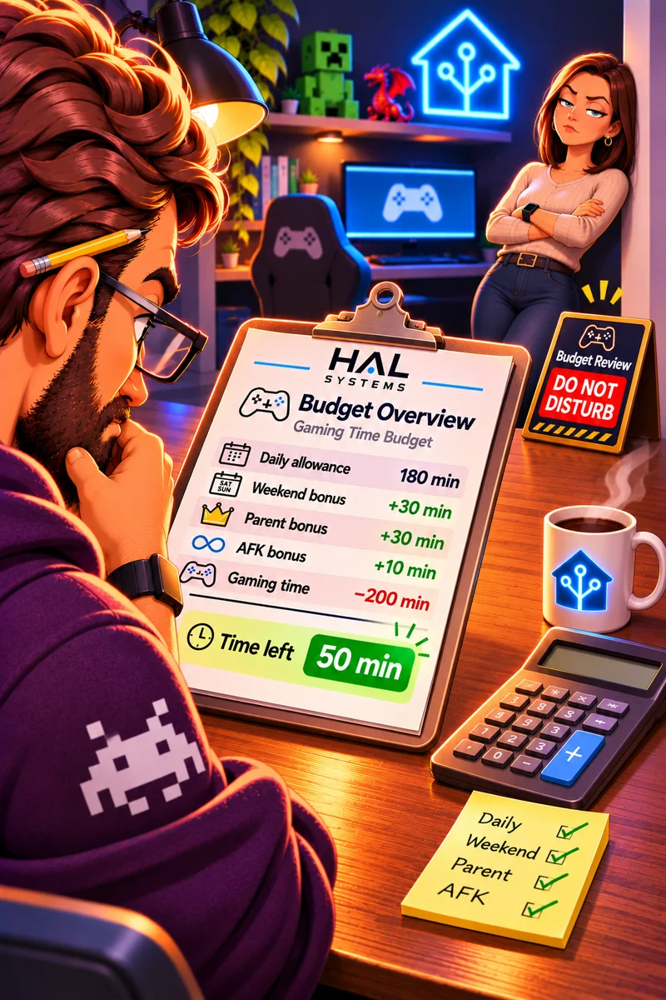

# Budget Overview

[← Back to features](../../README.md#what-can-it-do) · [All guides](../README.md)

  

**Planned — not implemented.** The itemized Budget Overview does not exist in the released Home Assistant interface yet. See [design issue #93](https://github.com/mhalak/smarthouse-parental-control/issues/93).

**Budget Review — DO NOT DISTURB.** When someone asks “Where did my gaming time go?”, the family accountant should be able to show a simple receipt.

## What it would show

A clear breakdown for **one child's PC**, using example values:

| Item | Minutes |
| --- | ---: |
| Daily allowance | 180 |
| Weekend bonus | +30 |
| Parent bonus | +30 |
| Screen idle bonus | +10 |
| Gaming time used | −200 |
| **Time left today** | **50** |

**This is an example, not live Home Assistant data.** Some bonuses shown here are themselves planned.

Each bonus would appear on its own line. **Measured gaming time would stay unchanged** even when a bonus adds more daily allowance.

## Where would it appear?

The first version is planned as a **native Home Assistant Markdown dashboard card**. No extra frontend card should be required.

**Weekly limits remain independent.** An extra 30 minutes today does not grant 30 extra minutes for the week.

Technical design & data quality

- A standard Home Assistant **device info page cannot be extended with arbitrary Markdown** by a Python integration; a custom frontend is a later idea.
- The integration would need one consistent per-PC snapshot of daily allowance, separate bonus types, measured usage, daily remaining and weekly remaining.
- Missing or incomplete Recorder history must be reported as **unknown or incomplete**, not as fake zero.
- A bonus event ledger would prevent duplicate awards after MQTT reconnects, restarts or repeated display events.
- The proposed Screen idle bonus increases today's allowance; it must **never subtract recorded daily, weekly or per-app gaming time**.
- Real Home Assistant screenshots can only be added after the feature is implemented and tested.

*The clipboard and “50 min” total are fictional example art, not a screenshot of an existing feature.*

[Gaming budgets](gaming-budgets.md) · [AFK / Screen idle bonus](screen-idle-bonus.md) · [Known limitations](../known_limitations.md)
