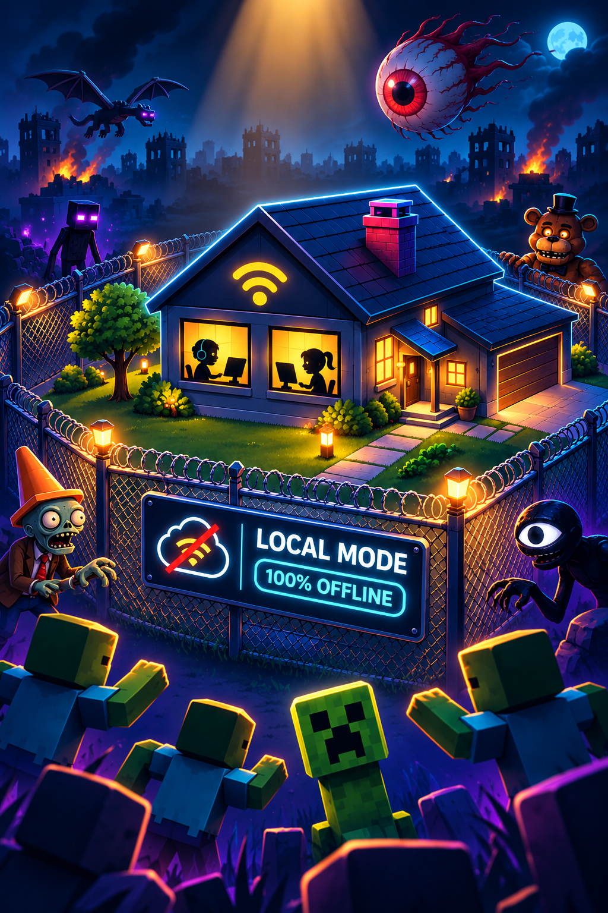

# 100% local mode — the monsters stay outside. So does the cloud.

[← Feature index](../../README.md#feature-local-mode) · [All guides](../README.md)

[Gaming budgets →](gaming-budgets.md)

<table>
  <tr>
    <td width="32%" valign="middle">
      
    </td>
    <td valign="middle">
      <h3>Cloud? Sorry, wrong address.</h3>
      
There are enough monsters outside the fence. We don't need another one hosting the parental-control server.

    </td>
  </tr>
</table>

**Local by design:** Core gaming activity reporting, Home Assistant budgets and manual parent controls do **not** rely on an external web service, vendor account, cloud API or subscription. The Windows companion service, MQTT broker and Home Assistant communicate over **your own local network**.

## Why we built a Windows service

We wanted to control our PCs without asking someone else's server for permission. That's why HAL Gaming Control has its own **Windows service** running on each managed computer. It observes supported application activity, reports it through MQTT and receives authorized **Lock PC** and **Terminate game** commands. The Home Assistant integration handles the tracking choices, friendly app names, budgets and controls.

`Windows service on your PC ⇄ your MQTT broker ⇄ your Home Assistant`

- **Windows service:** The local companion that reports PC activity and performs supported manual actions on that PC.
- **MQTT broker:** A broker **you host**, carrying reports and control messages inside your network.
- **Home Assistant:** The local place to see activity, configure tracked applications and budgets, and issue parent controls.

No proprietary online parental-control backend sits between the parent and the PC. We built the missing piece ourselves. *A surprisingly productive way to avoid another monthly subscription.*

### Meet the Windows companion service

This is a **background Windows service**, not another app your child has to remember to launch. Install it on each managed Windows PC and connect it to your own MQTT broker. Once configured, it starts with Windows and forms the local bridge between that computer and Home Assistant.

Its job is deliberately focused:

- **Observe locally:** Detect supported foreground application activity on the PC and send the relevant application identity and state through MQTT.
- **Report locally:** Publish activity, availability and diagnostic information to the configured MQTT broker so Home Assistant can display and use it.
- **Act locally:** Listen for supported, authorized Home Assistant commands and perform **Lock PC** or **Terminate game** on that computer.

**Home Assistant owns the rules:** The list of tracked applications, their friendly names, and the gaming budgets live in Home Assistant. The Windows service is the eyes and hands on the PC, not a separate cloud-based decision maker.

*The robot handles the paperwork. The parents still get the final say.*

## What if the internet goes down?

If **your LAN, Home Assistant, MQTT broker and Windows service** are still running and can communicate, core tracking and manual controls can continue without an internet connection. No cloud round-trip is needed to tell the PC to lock.

This isn't magic offline enforcement, though: if the **broker, Home Assistant or local network** becomes unavailable, the control path can break and tracking can have gaps. Missing activity isn't proof of zero playtime. There is no cloud fallback, and **automatic restriction/enforcement is not yet validated** in this development preview.

Internet access may still be useful for **initial downloads, software updates, HACS or optional online data sources**. These are separate from the local control path. If you choose to expose Home Assistant remotely, secure that access; local-first does not mean the whole setup is automatically inaccessible from the internet.

## Maybe one day: an Android companion 📱

**Future idea — not implemented or scheduled.** We'd like to build an **Android companion app** too, bringing the same local-first philosophy to compatible Android devices. The goal would be to connect those devices with Home Assistant without making a vendor cloud service the middleman.

What Android will actually let us monitor or control, and which permissions would be required, still needs investigation. This is **not a promise of Android screen-time enforcement** or feature parity with Windows.

*Coming when we get around to it. Apparently the development team also has a daily screen-time budget.*

## Privacy and security still matter

- Keep MQTT credentials private and restrict each Windows service account to its own topics.
- Keep Home Assistant, the broker and Windows PCs secured and updated.
- A Windows administrator can still interfere with the service; this is a family management tool, not tamper-proof security.
- **Terminate game** may lose unsaved progress. Test actions on your own PC before relying on them.

**Development preview:** Manual **Lock PC** and **Terminate game** actions have only been tested on a limited number of PCs. Check [known limitations](../known_limitations.md) before enabling restrictions.

For setup, see [Getting started](../getting-started.md), [Windows installation](../windows_deployment.md) and [MQTT setup](../mqtt_setup.md). For implementation and telemetry details, see [MQTT and privacy](../mqtt_protocol.md).

---

**Explore more features:** [Gaming budgets →](gaming-budgets.md)
