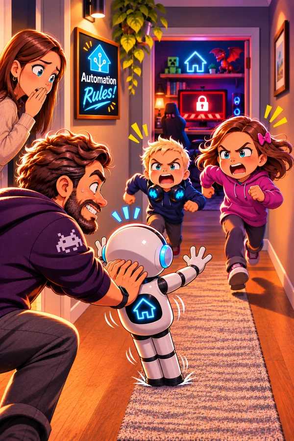

# Controls & automations

[← Back to features](../../README.md#what-can-it-do) · [All guides](../README.md)

  

**Available in development preview:** **Lock PC** and **Terminate game** have passed limited real-PC smoke tests. **Automatic restriction enforcement is not yet validated or enabled by default.**

**Automation Rules!** Let Home Assistant handle the reminders so you can stop personally negotiating the seventh “five more minutes.”

## Use a manual control

1. Open the **correct child's PC** in Home Assistant.
2. Check that the Windows agent is connected and reporting fresh information.
3. Choose the action you need:

   - **Lock PC:** Locks the Windows session. The child can unlock it normally; a running game may stay open.
   - **Terminate game:** Closes configured matching game processes. **Unsaved progress can be lost.**

These are explicit actions. Simply adding an application to the tracked list does **not** close it.

## Why use Home Assistant automations?

The real benefit is choosing your own rules: a notification, a short grace period, another reminder, or a parent-approved consequence. Home Assistant already has tools for building these workflows.

**Do not enable automatic locking or game termination yet.** The device-specific restriction trigger and its safe end-to-end behavior still need real-world validation.

Advanced automation safety notes

- A future workflow could check a **fresh, device-specific Gaming restriction active** signal, send a warning, wait, check again, and only then act.
- A daily or weekly budget sensor **by itself is not permission to close a game**. Missing, stale or unavailable data is **not** a confirmed restriction.
- Test any future destructive automation with disposable game sessions first; verify the exact versions and PC selection.
- For current technical details, see [automation-only command execution in the HA integration reference](../ha_integration.md#automation-only-command-execution--050-preview).
- A real screenshot of the manual controls is still pending a sanitized capture.

*The frightened robot is conceptual artwork, not a screenshot or evidence that automatic enforcement is already running.*

[Gaming budgets](gaming-budgets.md) · [Windows deployment](../windows_deployment.md) · [Known limitations](../known_limitations.md)
