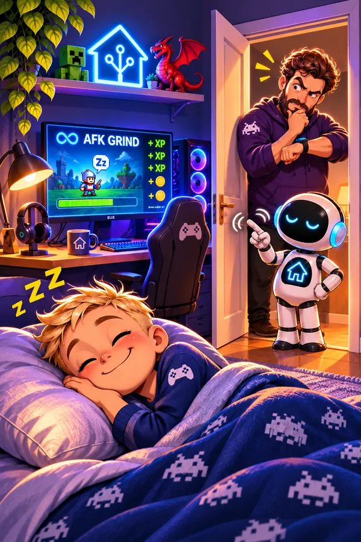

# AFK grind & Screen idle bonus

[← Feature index](../../README.md#feature-screen-idle-bonus) · [All guides](../README.md)

[← Controls & automations](parent-actions.md) · [Budget Overview →](budget-overview.md)

<table>
  <tr>
    <td width="32%" valign="middle">
      
    </td>
    <td valign="middle">
      <h3>The loot won't mine itself ⛏️</h3>
      <p>Kid asleep. Minecraft's working the night shift like it has a mortgage. Our robot refuses to bill the gaming budget for a pickaxe's overtime.</p>
    </td>
  </tr>
</table>

As responsible parents, we want our kids to succeed. And the loot isn't going to mine itself. The game can work the night shift — the gaming budget shouldn't have to.

**End-to-end source preview — OFF by default, not deployed or validated on family PCs.** Windows observes logical console **ON / DIM / OFF**, timeout and session idle. HA now has an experimental per-device opt-in, a fail-closed display gate and a separate, replay-safe **daily** Screen idle bonus journal. It requires verified measured gaming time and a plausible **automatic Windows timeout**, not simply an OFF packet. A console OFF report is not proof that every physical monitor is dark, and gamepads/manual power-off still require supervised real-PC tests. [Design issue #92](https://github.com/mhalak/hal-gaming-control/issues/92).

## How would it work?

1. A child leaves a game running and walks away.
2. Until Windows **confirms the screen is off**, gaming time still counts.
3. Once the screen is off, the PC could stay awake and keep grinding, but **new screen-off minutes would stop counting as playtime**.
4. Parents could optionally grant a **daily bonus** for eligible inactive minutes **before** the screen turned off.

The bonus adds to today's allowance. **It doesn't erase recorded playtime or raise the weekly limit.**

## An example

The child leaves Roblox at **16:30**, but the screen stays on until **16:40**. Those 10 minutes are still recorded.

If reliable data confirms the child wasn't playing, the parent could award **+10 daily minutes**. Once the screen is off, no new playtime would count while it stays off.

The PC must stay **awake** for the game to continue. Screen off is not the same as Windows sleep.

## What needs testing?

Manually switching off a monitor must not invent bonus minutes. Missing information must not earn a reward. Gamepads, multiple monitors, reconnections and games that prevent screen-off also need testing.

Until then, this is a plan, not a promise. Even the robot knows better than to guess.

**For developers:** [Original design notes](../reference/features/screen-idle-bonus-preview-notes.md).

More: [Gaming budgets](gaming-budgets.md)

---

**Explore more features:** [← Controls & automations](parent-actions.md) · [Budget Overview →](budget-overview.md)

## Developer preview — Windows display context

In the Windows agent source, `display_context.py` reads `VIDEOIDLE` for the active power plan using Win32 power APIs, reporting configured **AC** and **DC** timeouts in seconds. `0` means Windows is configured to **never** turn the display off automatically on that power source. The foreground helper (which runs in the active interactive user session, not Session 0) separately reads `GetLastInputInfo` and returns the approximate age in milliseconds of the last session input. Failures, a locked or unconfirmed session, or input-age ambiguity yield `null` rather than fabricated activity.

The agent can publish a non-retained, 45-second-expiry, device-scoped MQTT JSON snapshot on `SmartHouse/Gaming/<device_id>/state/display_context` approximately every 30 seconds after its normal telemetry is synchronized. The schema is:

```json
{
  "version": 2,
  "device_id": "example_pc",
  "observed_at": 1790000000.0,
  "display_state": "off",
  "display_scope": "windows_console",
  "display_event_age_ms": 1500,
  "display_epoch": "0123456789abcdef0123456789abcdef",
  "display_sequence": 12,
  "ac_timeout_seconds": 600,
  "dc_timeout_seconds": 300,
  "power_source": "ac",
  "last_input_idle_ms": 120000
}
```

Values are illustrative, not readings from a family PC. An interactive-user helper registers a hidden, non-focus-stealing Windows top-level window using `RegisterPowerSettingNotification(GUID_CONSOLE_DISPLAY_STATE)`, and reports console `on`, `dim`, `off` or `unknown` with `display_event_age_ms`. It invalidates stale/locked-session, sleep/resume, topology-change and missing-event results to `unknown`. All values share this existing `display_context` JSON packet; no new HA entities were introduced. **A console `off` event cannot prove all physical monitors are off**, does not distinguish automatic from manual off, and `GetLastInputInfo` cannot reliably see every game controller. Neither timeout nor state by itself authorizes a Screen idle bonus. A real SYSTEM + interactive-user pilot and later HA source-of-truth accounting are still needed. No Windows power setting or game process is modified.

[High-priority issue #176](https://github.com/mhalak/hal-gaming-control/issues/176) covers future consolidation of **all** Windows monitoring into one versioned per-PC JSON snapshot. The present Windows change stays on the existing display-context topic until HA and Windows can migrate their authoritative gaming telemetry together, without double-counting.

## HA experimental Screen idle opt-in (issue #92)

Screen idle is **disabled by default**. In the configured PC's Home Assistant integration, open **Configure → Screen idle (experimental)** and explicitly acknowledge the preview limitations before enabling. Do not enable it on children's devices until a supervised Windows SYSTEM + interactive-session test verifies real hardware behavior and trusted MQTT publishing. The Windows service remains telemetry-only; HA retains all policy and time accounting.

Under the preview, HA subscribes to the **existing one-packet** `SmartHouse/Gaming/<device_id>/state/display_context` JSON alongside the raw foreground stream. The current **display protocol v2** adds `display_epoch` (128-bit session identifier) and `display_sequence` (monotonic per-observer event receipt) to the previously combined ON/OFF state, `display_event_age_ms`, AC/DC timeout, power source and input age. The future *all-telemetry* consolidation remains [P1 issue #176](https://github.com/mhalak/hal-gaming-control/issues/176); the legacy game/activity MQTT topics are **not** removed here.

HA requires non-retained, per-device, correctly typed v2 packets that are fresh by wall clock, with valid event IDs. It discards or invalidates malformed, cross-device, replayed, disconnected or expired observations. When a live authenticated console OFF is current, the HA-owned **Active game** alias becomes `idle` and new tracked foreground intervals stop accumulating. Measured and persisted time *before* OFF is never subtracted. After ON, new positive accounting requires a fresh pair of successive verified raw foreground samples; unknown or missing display observations never create free minutes.

A **daily Screen idle bonus** is only possible for a distinct, newly observed ON→OFF event from the same helper session, seen within five seconds of the actual event, with fresh previously *confirmed, continuously measured* foreground intervals and plausible AC/DC timeout evidence. An OFF event immediately following user input, an unset/zero timeout, unknown power source, missing input evidence, gaps in measured game activity, stale events or a local-midnight/DST boundary fail closed to **zero**. Windows GetLastInputInfo does not capture every controller, and logical console OFF cannot distinguish all manual/multi-monitor cases: that's why the entire preview requires deliberate opt-in and real-PC verification.

Eligible verified whole minutes are bounded at 120 per event and 180 per local HA day, persisted in a separate config-entry `screen_idle_bonus_journal` using the Windows helper epoch/sequence. Duplicates and reconnect/restart replays do not grant again. It **adds to daily allowance only**; it does not alter daily/weekly measured time, the independent weekly limit, the Parent bonus history or weekend bonus. Budget Overview exposes `screen_idle_bonus_minutes` and a preview/disabled status as attributes of the existing daily budget sensor, **without adding separate HA entities**. Daily bonuses reset for effective allowance at local midnight while retaining a bounded audit history.

**Validation status:** unit/integration test coverage and CI are necessary but not sufficient; hardware acceptance and full controller/multiple-monitor verification remain outstanding. Do not disable Windows Defender, Smart App Control or OS security to run this preview.
