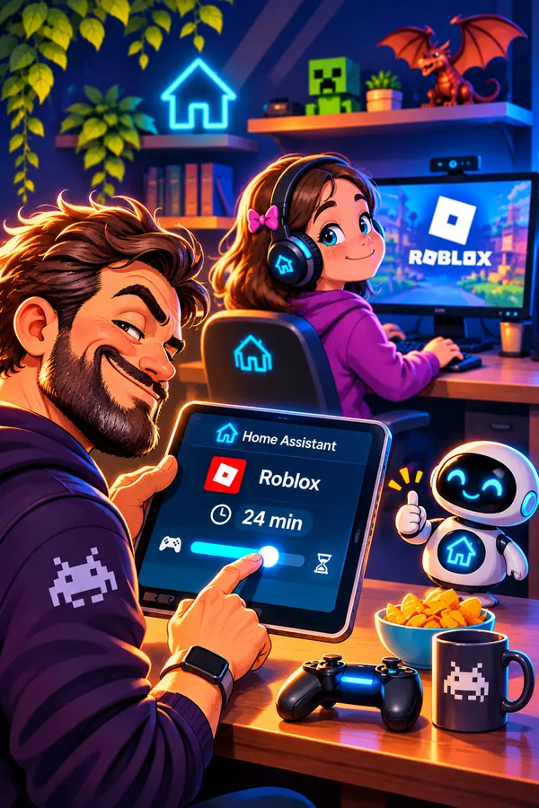

# Track applications

[← Back to features](../../README.md#what-can-it-do) · [All guides](../README.md)

  

**Available in development preview:** The Home Assistant application editor is included in the HA 0.5.10 preview source. Full end-to-end tracking still needs validation on each PC.

Track Roblox, Minecraft, or any other application you choose. Windows reports what is in the foreground; **Home Assistant gives it a friendly name**. The family detective knows who is hiding behind that process name.

## Add an application

1. Start the application on the child's PC and bring it to the front.
2. In Home Assistant, open **Settings → Devices & services → SmartHouse Parental Control** and select the correct PC.
3. Open **Configure → Tracked applications**. Check **Currently detected application** to make sure it is the right one.
4. Under **Application List**, choose **Add**, enter a friendly name such as **Roblox**, and press **Add** in that dialog.
5. **Important: press Save changes in the main window too.** Otherwise, your new entry is not saved.
6. Reopen **Tracked applications** to check that it is on the list.

**Using a phone?** The keyboard's Enter key does not submit the inner **Add** dialog in the current native HA editor. Tap **Add**, then **Save changes**.

## What is actually tracked?

A Windows process such as **RobloxPlayerBeta.exe** can appear as **Roblox**. Java apps need a safe extra identifier to tell Minecraft apart from other programs using **javaw.exe**.

The Windows companion **reports application identity**; the friendly names and tracked-app list stay in **Home Assistant**, not on the child's PC.

Troubleshooting & technical notes

- **Wrong app shown?** Detection is a snapshot taken when you open the editor. Close it, focus the correct Windows app, then reopen the editor.
- **My entry disappeared?** Make sure you pressed the outer **Save changes** button.
- **Not tracked** means the detected app is not in this PC's list. **Idle** and **Unavailable** mean different things; do not treat them as the same state.
- Java matching uses a limited safe class/JAR/module identifier where available, **not** private file paths or full command lines. If an app cannot be safely identified, do not guess.
- Adding an application does not automatically authorize **Terminate game**. End-to-end foreground time accounting still needs device-specific testing.
- The editor's detailed UI may vary across preview versions. Real sanitized screenshots are pending. See the [screenshot checklist](../assets/screenshots/README.md).

*The tablet and slider in the illustration are fictional, not a released Roblox control screen.*

[Gaming budgets](gaming-budgets.md) · [Controls & automations](parent-actions.md) · [HA integration guide](../ha_integration.md)
