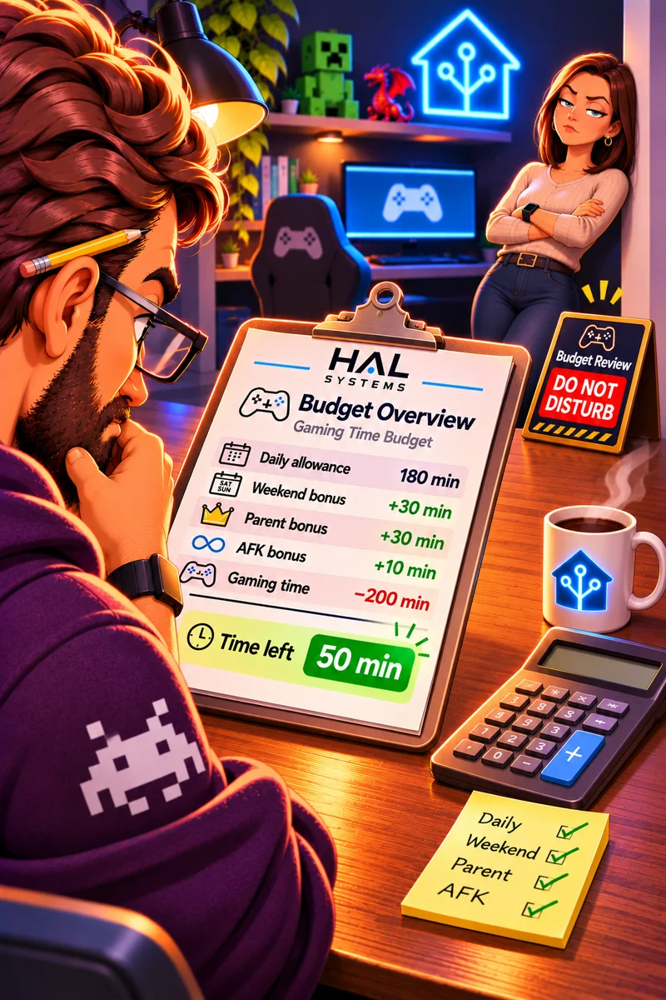

> **Archived engineering notes (21 November 2026).** These notes cover specific development versions and may be outdated. For the shorter parent-facing guide, [start here](../../features/budget-overview.md).

---

# Budget overview — the gaming-time receipt

[← Documentation](../../README.md) · [← Project home](../../../README.md)

**Status: planned; not implemented.** See [design issue #93](https://github.com/mhalak/hal-gaming-control/issues/93). The existing daily/weekly entities are not yet an itemized Budget overview.

<table>
  <tr>
    <td width="132" valign="middle">
      
    </td>
    <td valign="middle">
      <h3>Budget Review — DO NOT DISTURB</h3>
      <p>The family gaming-time auditor has receipts. Mum is distinctly unimpressed. The breakdown below is an illustration of a planned feature, not live data.</p>
    </td>
  </tr>
</table>

*Conceptual illustration only — not a screenshot of Home Assistant or proof of released behavior.*

> When a child asks, "Where did all my time go?", you should be able to show a receipt without opening twelve sensors or doing arithmetic on the fridge.

## Proposed per-PC display

Example only — **not live Home Assistant data**:

```text
Gaming budget — Today

+180 min   Daily budget
 +10 min   Screen idle bonus
 +30 min   Parent bonus
-----------------------------
 220 min   Total daily budget
-210 min   Measured gaming time
-----------------------------
  10 min   Remaining today

Weekly remaining: shown separately
```

On weekends, the **Weekend bonus** appears as a separate positive line. Each press of **Add 30 minutes** increases the Parent bonus line for the current day.

The **Screen idle bonus is a true, parent-approved daily bonus**, **not** a correction to measured usage. In this example, daily and weekly **measured** gaming time remain 210 minutes. The daily allowance is 220; daily remaining is 10. A weekly cap is *not* raised by any of these daily bonuses, so the weekly restriction may still be binding.

## Where will it live?

The first implementation target is a **native Home Assistant Markdown dashboard card** reading a structured, per-PC breakdown from the integration. This requires no extra HACS card or custom JavaScript.

**Important limitation:** the standard Home Assistant **Settings → Devices & services → Device info** page does not allow a Python integration to insert arbitrary Markdown into the middle of its default entity list. A custom frontend for that page is deferred; the Markdown dashboard card is the near-term plan.

## Where will the data come from?

The integration should expose a consistent structured snapshot (not a string of independently rounded guesses) with these fields:

- Daily base allowance and, when applicable, separate Weekend, Parent and Screen idle bonus minutes.
- Effective daily total and current measured gaming time.
- Daily remaining and **weekly remaining** / weekly availability.
- Source freshness and incomplete Recorder coverage, without reporting missing values as fake zero.

Bonus grants need an event ledger to avoid duplicates on reconnect, restart or repeat display-off messages. A Screen idle bonus increases **daily allowance**; measured per-app/daily/weekly time remains recorded. Parent-granted bonuses remain separate from Screen idle awards.

## Screenshot plan

**Screenshot pending — cannot capture until this feature exists and is deployed:**
1. The itemized Markdown dashboard card with sanitized example PC label and the five ledger rows.
2. A Screen idle bonus being added after a verified display-off event.
3. Daily budget remaining alongside the **independent weekly remaining** state, including an exhausted-weekly example.

No mocked screenshot should be presented as proof of a shipped feature. See [screenshot checklist](../../assets/screenshots/README.md).

### Related
[Gaming budgets](../../features/gaming-budgets.md) · [Screen idle bonus](../../features/screen-idle-bonus.md) · [Issue #93](https://github.com/mhalak/hal-gaming-control/issues/93)
