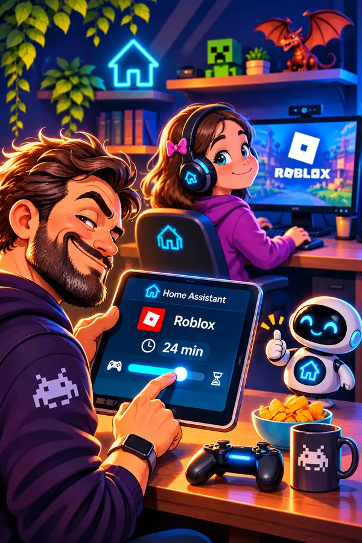

> **Archived engineering notes (21 November 2026).** These notes cover specific development versions and may be outdated. For the shorter parent-facing guide, [start here](../../features/tracked-applications.md).

---

# Track any application

[← Documentation](../../README.md) · [← Project home](../../../README.md)

**Status:** Home Assistant Tracked applications editor is in the current development preview (HA source 0.5.10). Full cross-device, foreground accounting and deployment acceptance remain separate work. This isn't a Windows-side game list.

<table>
  <tr>
    <td width="132" valign="middle">
      
    </td>
    <td valign="middle">
      <h3>The family app detective</h3>
      
The computer reports the active app; Home Assistant decides which name appears on the scoreboard. Even <code>javaw.exe</code> deserves an identity check.

    </td>
  </tr>
</table>

*Conceptual illustration only — not a screenshot of Home Assistant or proof of released behavior.*

> Roblox gets screen time. Minecraft gets screen time. If you want your child's spreadsheet skills to count as gaming, well, you're the parent.

## What you can track

Any detectable foreground executable can be placed on the per-PC tracked application list, including non-games. Home Assistant assigns a friendly name you choose. For example, `RobloxPlayerBeta.exe` can display as **Roblox**.

Java applications need more care: `java.exe` or `javaw.exe` alone is ambiguous, so the Windows companion provides a minimal *safe* Java class/JAR/module signature when it can. This distinguishes Minecraft from another Java application without exporting command lines or private paths. Some apps cannot be safely identified and shouldn't be guessed.

The PC only observes and reports. **Names and tracked-app settings live in Home Assistant**, not in the child's Windows configuration.

## Add an application

1. Confirm the Windows companion and Home Assistant integration are installed and sending fresh telemetry. Start the application on the child's PC and bring it to the foreground.
2. In Home Assistant, open **Settings → Devices & services → SmartHouse Parental Control**. Choose the correct PC's integration entry, then **Configure → Tracked applications**.
3. Review **Currently detected application**. It should show the safe raw executable identity (and Java signature where applicable). The editor captures a *snapshot when you open this step*. If the wrong app appears, close the dialog with **X**, focus the right app on Windows, and reopen **Configure → Tracked applications**.
4. In **Application List**, choose **Add**, supply your friendly name and confirm the inner **Add** dialog. You can similarly edit or remove existing entries.
5. **Important: press the outer Save changes button as well.** The inner Add/Edit/Delete dialog only changes the draft list displayed on screen. Closing without **Save changes** discards these edits.
6. Reopen Tracked applications to confirm the persisted mapping. The final user-facing Active game behavior depends on the separately validated foreground cutover; do not treat adding a name as proof that all accounting is correct.

**Mobile note:** the on-screen keyboard's Enter action cannot submit the inner Add dialog through the native Home Assistant selector. Tap the actual **Add** button, dismiss the keyboard if needed, then tap the outer **Save changes** button. A single-step editor is deferred to [future custom frontend work](https://github.com/mhalak/smarthouse-parental-control/issues/89).

## What should the screen look like?

**Screenshot pending — current HA preview, to be captured on a sanitized test setup:**

1. **Currently detected application** showing a public executable basename and friendly name.
2. **Application List** showing Add/Edit/Delete for two sample entries.
3. **Save changes** visible on a mobile screen, including the double-confirmation behavior.

See the [capture checklist](../../assets/screenshots/README.md). Do not substitute screenshots from a different version; the form changed between HA 0.5.8, 0.5.9 and 0.5.10.

## Troubleshooting

- **The wrong app appears:** focus the desired Windows app, close the HA Options Flow completely and reopen Tracked applications. The preview does not live-refresh.
- **It says Not tracked:** the detected app has not been enrolled in this PC's list. An explicit Idle means no tracked application is active; Unavailable means insufficient reliable telemetry. These states are not interchangeable.
- **Bare Java cannot be added as Minecraft:** a stable, safe distinguishing Java signature is required. Never paste the entire launch command containing auth tokens.
- **My new entry disappeared:** check whether the outer **Save changes** was pressed.

This feature is independent of **Terminate game**: adding an application for tracking does not itself authorize a remote game-closing action.

### Related
[Gaming budgets](../../features/gaming-budgets.md) · [Screen idle bonus — planned](../../features/screen-idle-bonus.md) · [HA integration guide](../../ha_integration.md) · [Product direction](../../product_direction.md)
